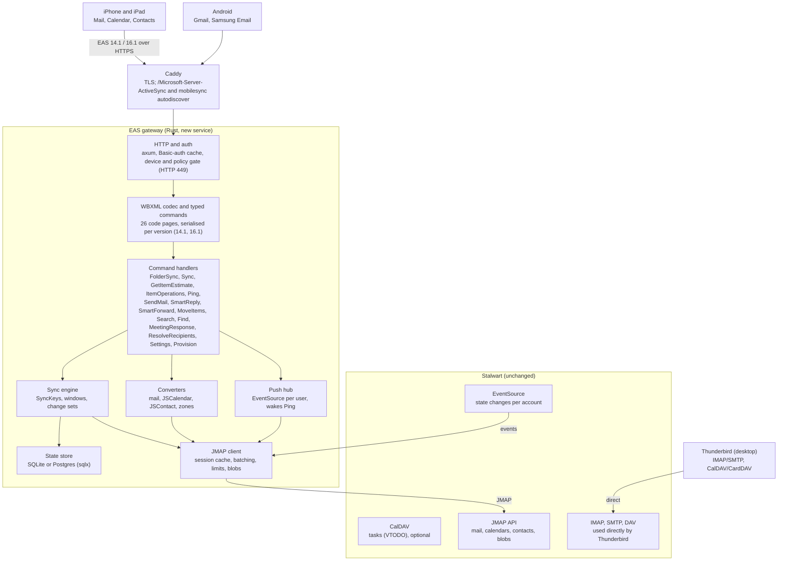
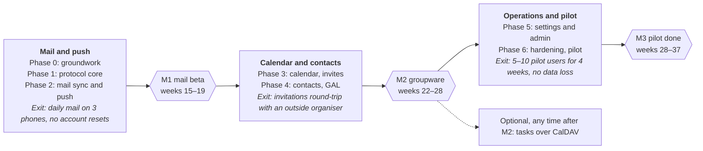

# Exchange ActiveSync gateway for Stalwart — Rust plan for mobile devices

As of 19 Oct 2026. Living version: the Claude Docs document this file was exported from.

## Summary

Build a standalone ActiveSync (EAS) gateway in Rust that serves phones and tablets only and talks to Stalwart over JMAP. Desktop users run Thunderbird against Stalwart directly, so Outlook is out of scope and the client list shrinks to iOS, the Gmail app on Android and Samsung Email.

- **Effort:** 140–186 person-days, about 28–37 person-weeks for one experienced Rust developer (roughly 6½–8½ months full-time). Optional tasks sync adds 6–8 days.
- **Milestones:** mail and push beta after weeks 15–19; calendar and contacts after weeks 22–28; production pilot done after weeks 28–37.
- **Against the earlier 32–45 weeks:** dropping Outlook removes its quirks and a whole test column. Nothing else gets cheaper, because there is no Z-Push underneath to inherit client fixes from.
- **Where the time goes:** about 30% into mail sync and push, 18% into calendar conversion, 15% into hardening on real devices. AI-assisted coding speeds up the first two, not the third.

## Scope

The gateway covers what a phone's built-in apps sync over EAS, and nothing a desktop needs.

| Area | In scope | Out of scope |
| --- | --- | --- |
| Clients | iOS and iPadOS Mail, Calendar, Contacts; Gmail app on Android; Samsung Email; other EAS mobile clients on a best-effort basis | Outlook for Windows and Mac; Outlook for iOS and Android, which syncs through Microsoft's cloud instead of connecting directly ([Microsoft Learn](https://learn.microsoft.com/en-us/exchange/clients/outlook-for-ios-and-android/use-basic-auth)) |
| EAS versions | 16.1 and 14.1; 14.0 and 16.0 announced as well | 2.5, 12.0, 12.1 |
| Data | Email, calendars, contacts; tasks as an optional phase | Notes, documents, rights management, SMS |
| Features | Push, provisioning and remote wipe, out-of-office, server-side mail search, directory (GAL) search, meeting invitations | S/MIME certificate lookup; shared and delegated mailboxes in the first release |
| Desktop | Thunderbird on Stalwart's own IMAP, SMTP, CalDAV and CardDAV, untouched by the gateway | Any desktop client through the gateway |

Tasks only pay off for clients that sync them, such as Reminders on iOS, so they wait until users ask. Targeting 16.1 first matters: Exchange Online has required it since March 2026, so Samsung Email speaks it and Gmail was due to follow ([Duquesne IT notice](https://services.duq.edu/TDClient/30/Portal/KB/ArticleDet?ID=573)); 14.1 covers older Android devices.

## Architecture

Phones reach the gateway through Caddy; the gateway reaches Stalwart only through JMAP and its EventSource stream. Thunderbird bypasses the gateway entirely.

Each layer calls only the one below it, and the JMAP client is the only part that talks to Stalwart, so a Stalwart upgrade can only break one crate.

- **Deployment:** one container in the k3s cluster, one replica to start, SQLite on a persistent volume.
- **Routing:** Caddy sends `/Microsoft-Server-ActiveSync` and `/autodiscover/autodiscover.xml` to the gateway with read timeouts above an hour; everything else stays on Stalwart. The gateway passes non-`mobilesync` autodiscover requests on to Stalwart.
- **Operations:** `/metrics` for Prometheus and the admin API listen on an internal port, never exposed through Caddy.
- **Stalwart settings:** forwarded-header handling on, so failed logins count against the phone's IP, not the gateway's.

## Request flows

Two commands carry almost all traffic: `Sync` moves data, `Ping` waits for changes. Both run through the same front half.

**Sync**

1. Caddy terminates TLS, adds `X-Forwarded-For` and passes the request to the gateway.
2. The gateway reads `Cmd`, `User`, `DeviceId` and `DeviceType` from the query string (plain or base64 form) and the `MS-ASProtocolVersion` header.
3. Basic credentials are checked against a short-lived cache, or else by opening the user's JMAP session. The client's IP goes along to Stalwart, so its fail2ban blocks the device, not the gateway.
4. Device gate: an unknown or unprovisioned device gets HTTP 449; a device marked for wipe gets the wipe instruction on its next `Provision`.
5. The WBXML body is decoded into a typed `Sync` request.
6. The gateway locks the device and folder, then looks up the client's SyncKey. Current key: continue. Previous key: replay the stored response, because the client lost it. Unknown key: status 3, and the client resyncs that folder.
7. Client changes (add, change, delete, fetch) go to Stalwart in one batched JMAP call; each new item's `ClientId` is stored so a retried add doesn't create duplicates.
8. Server changes come from `/changes` since the stored JMAP state, filtered to this folder and the client's time window, minus the echoes of the client's own edits.
9. Up to `WindowSize` items go into the response; the rest stay pending with `MoreAvailable` set.
10. New SyncKey, JMAP state and pending set are written in one transaction, then the response is encoded and sent.

**Ping**

1. The device names folders and a heartbeat of up to 59 minutes, or sends an empty `Ping` to reuse its last set.
2. If a watched folder already has pending changes, the gateway answers at once.
3. Otherwise the request subscribes to the push hub, which keeps one JMAP EventSource connection per user with an active device.
4. A state change for mail, mailboxes, events or contacts triggers a cheap `/changes` check; the gateway answers status 2 with the folders that really changed.
5. With no change before the heartbeat ends, it answers status 1 and the device pings again. Caddy and any ingress need read timeouts longer than the longest heartbeat.

## Code layout

One Cargo workspace with six crates, split so the protocol and the conversions can be tested without a network or a database.

| Crate | Owns | Main dependencies |
| --- | --- | --- |
| `eas-wbxml` | WBXML tokens, the 26 EAS code pages, encoder and decoder; no I/O, fuzzable | none |
| `eas-proto` | Typed requests, responses and data classes, serialised per protocol version (14.1, 16.1) | `eas-wbxml` |
| `eas-jmap` | JMAP session, batched calls with back-references, `/changes`, blobs, EventSource, per-user concurrency limit | `reqwest`, `serde_json`; optionally `jmap-client` 0.4 |
| `eas-convert` | Email, JSCalendar and JSContact mapping, recurrence rules, Windows time-zone blobs | `mail-parser`, `mail-builder`, `calcard`, `chrono-tz` |
| `eas-state` | Device and sync state, schema migrations | `sqlx` (SQLite, Postgres) |
| `eas-server` | HTTP app: auth, dispatcher, command handlers, push hub, autodiscover, admin API, metrics | `tokio`, `axum`, `tower`, `tracing`, Prometheus exporter |

`mail-parser`, `mail-builder`, `calcard` and `jmap-client` come from Stalwart Labs under Apache-2.0 OR MIT, so the gateway can pick its own licence. AGPL-3.0 is the practical choice: it lets you port workarounds from Z-Push and grommunio-sync (both AGPL) instead of rediscovering them.

## State model

The gateway stores bookkeeping only; losing its database costs every device one full resync, never any mail.

| Table | Key | Holds |
| --- | --- | --- |
| `devices` | user, device ID | Device type, user agent, EAS version, policy key, wipe status, blocked flag, first and last seen |
| `folders` | device, folder ID | Short EAS folder ID, JMAP object kind and ID (mailbox, calendar, address book), EAS folder type, parent |
| `hierarchy_state` | device | Current and previous FolderSync key; JMAP states for mailboxes, calendars and address books |
| `sync_state` | device, folder | Current and previous SyncKey, JMAP state, time-window filter, IDs still pending, stored last response for replay |
| `items` | device, folder, item ID | JMAP ID and a hash of what the device last received, used to spot real changes in events and contacts |
| `client_ids` | device, client ID | JMAP ID created for a device-side add, so a retried add is answered, not repeated |
| `ping_state` | device | Folders and heartbeat from the last `Ping` |

SQLite is enough for one replica and a few hundred devices. Postgres becomes worthwhile only if you run more than one gateway replica, which also needs per-device locks to move out of process.

## EAS commands mapped to Stalwart

Every EAS command has a JMAP counterpart in Stalwart today; only tasks need CalDAV.

| EAS command | Purpose | Stalwart call |
| --- | --- | --- |
| `OPTIONS` | Announce versions and commands | Static: offer 14.0, 14.1, 16.0, 16.1 |
| `Provision` | Policies, remote wipe | Gateway database |
| `FolderSync`, `FolderCreate/Update/Delete` | Folder tree for mail, calendars, contacts | `Mailbox`, `Calendar`, `AddressBook` `/get`, `/changes`, `/set` |
| `Sync` (mail) | Deltas both ways, read and flag state | `Email/changes`, `Email/get`; `Email/set` for keywords (`$seen`, `$flagged`), moves and deletes; `Email/import` for drafts (16.x) |
| `Sync` (calendar) | Events, recurrences, exceptions | `CalendarEvent/changes`, `/get`, `/set` |
| `Sync` (contacts) | Contacts | `ContactCard/changes`, `/get`, `/set` with patches |
| `Sync` (tasks) | Tasks | CalDAV `REPORT`/`PUT` on VTODO |
| `GetItemEstimate` | Count pending changes | `/changes` counts |
| `Ping` | Push | EventSource |
| `ItemOperations`, `GetAttachment` | Full items, attachments, empty folder | `Email/get` with body values; blob download; `Email/query` + `Email/set` |
| `SendMail` | Send device-built MIME | `Blob/upload`, `Email/import` to Sent, `EmailSubmission/set` |
| `SmartReply`, `SmartForward` | Server adds the original message | Fetch original via blob, rebuild MIME, then as `SendMail` |
| `MoveItems` | Move between folders | `Email/set` on `mailboxIds` |
| `MeetingResponse` | Accept or decline an invitation | `CalendarEvent/set` with participation status and `sendSchedulingMessages` |
| `Search`, `Find` | Mailbox and GAL search | `Email/query` + `SearchSnippet/get`; `Principal/query`, `ContactCard/query` |
| `ResolveRecipients` | Recipient lookup, free/busy | `Principal/query`; `Principal/getAvailability` |
| `Settings` | Out-of-office, device and user info | `VacationResponse`, `Identity/get` |

**Where the effort really goes**

- **Calendar conversion.** EAS recurrence can't express every RRULE, so some series degrade. Exceptions map well to JSCalendar overrides. EAS sends time zones as a Windows `TIME_ZONE_INFORMATION` blob that has to be converted to and from IANA zones.
- **Ghosting.** Devices omit properties they don't support. Updates must patch only what the device sent, or the device silently wipes contact fields it never knew about.
- **SyncKey semantics.** Window sizes, `MoreAvailable`, retries with the previous key and conflict handling all need exact behaviour; clients reset the whole account when they get them wrong.
- **SmartReply / SmartForward.** The server builds the final message from the original, including attachments and the right MIME structure.
- **Client quirks.** iOS, Gmail and Samsung each read the spec differently. Z-Push and grommunio-sync carry years of these fixes; read their handler for each command before writing yours.

## Work breakdown and effort

The core comes to 140–186 person-days (28–37 person-weeks), plus 6–8 days if tasks are added. Mail sync and push is the largest phase; calendar conversion is the riskiest.

| Phase | Work package | Person-days |
| --- | --- | --- |
| 0. Groundwork | Record WBXML traffic from an iPhone, a Gmail device and a Samsung device against an existing EAS server (the grommunio instance), turn it into replayable fixtures | 3–4 |
| 0. Groundwork | Repo, CI, Stalwart test container with seeded accounts, JMAP fixture builder | 2–3 |
| 0. Groundwork | Spec digest: MS-ASCMD, -ASEMAIL, -ASCAL, -ASCNTC, -ASAIRS, -ASPROV, -ASHTTP, with 14.1 versus 16.1 differences | 2–3 |
| 1. Protocol core | WBXML codec: tokens, encoder, decoder, 26 code pages, opaque data; fuzzed | 6–8 |
| 1. Protocol core | Typed command model, version-aware for 14.1 and 16.1 | 5–7 |
| 1. Protocol core | HTTP layer: `OPTIONS`, plain and base64 query forms, protocol headers, status codes (449, 401, 503 with Retry-After) | 4–5 |
| 1. Protocol core | Auth: Basic passthrough to JMAP, credential cache, client IP forwarded to Stalwart | 3–4 |
| 1. Protocol core | Device registry and `Provision`: policy document, policy keys, remote wipe and account-only wipe | 4–5 |
| 2. Mail and push | JMAP client: session, batched calls, state errors, blobs, concurrency limit | 4–5 |
| 2. Mail and push | `FolderSync`: mailbox tree, roles mapped to EAS folder types, short stable IDs | 3–4 |
| 2. Mail and push | Sync engine: SyncKey state machine with replay, windows, `MoreAvailable`, time filter, conflicts, `GetItemEstimate` | 12–15 |
| 2. Mail and push | Email serialisation: headers, read and flag state, categories, conversation IDs, body preferences (text, HTML, MIME), truncation, preview, attachments | 6–8 |
| 2. Mail and push | `ItemOperations`: bodies, attachments and MIME on demand, empty folder | 3–4 |
| 2. Mail and push | `SendMail`, `SmartReply`, `SmartForward`: MIME rebuild, identity choice, copy to Sent, submission | 6–8 |
| 2. Mail and push | `MoveItems`, flag and read changes, delete to Trash | 2–3 |
| 2. Mail and push | `Ping` and push hub: EventSource per user, fan-out, heartbeat bounds, folder change filter | 5–6 |
| 2. Mail and push | `Search` and `Find` on the mailbox: `Email/query` with snippets | 2 |
| 3. Calendar | Calendar folders and `Sync` over `CalendarEvent` | 3 |
| 3. Calendar | JSCalendar to EAS fields: attendees, reminders, busy status, 16.x location and client IDs | 8–10 |
| 3. Calendar | Recurrence and exceptions: RRULE to EAS recurrence, overrides, 16.x instance edits | 5–7 |
| 3. Calendar | Time zones: Windows `TIME_ZONE_INFORMATION` blob to and from IANA zones | 4–5 |
| 3. Calendar | Invitations: meeting data in mail, `MeetingResponse`, server-sent invitations in 16.x through `sendSchedulingMessages` | 6–8 |
| 4. Contacts and directory | JSContact to EAS contact fields, patch-only updates against ghosting, photos | 7–9 |
| 4. Contacts and directory | Address books as folders | 1–2 |
| 4. Contacts and directory | GAL search and `ResolveRecipients` via `Principal/query`; free/busy via `Principal/getAvailability` | 3–4 |
| 5. Settings and operations | `Settings`: out-of-office through `VacationResponse`, device and user info | 2–3 |
| 5. Settings and operations | Autodiscover for `mobilesync`; other schemas passed to Stalwart | 2 |
| 5. Settings and operations | Admin API and CLI (devices, wipe, block, reset), Prometheus metrics, redacted WBXML debug logs | 5–6 |
| 5. Settings and operations | Container image, k3s manifests, Caddy routes and timeouts | 2–3 |
| 6. Hardening and pilot | Device-lab regression on every build: current and previous iOS, two Gmail devices, one Samsung | 8–12 |
| 6. Hardening and pilot | Fuzzing the WBXML decoder, load test with 500 simulated `Ping`s | 3–4 |
| 6. Hardening and pilot | Microsoft EAS interop test suites (subset), go-activesync probes | 4–6 |
| 6. Hardening and pilot | Pilot with 5–10 users for four weeks, fix list | 5–8 |
| Optional | Tasks: EAS tasks to CalDAV VTODO | 6–8 |

Phase totals in person-days: groundwork 7–10, protocol core 22–29, mail and push 43–55, calendar 26–33, contacts and directory 11–15, settings and operations 11–14, hardening and pilot 20–30. At half time, the calendar duration roughly doubles to 13–17 months.

## Roadmap

Three stages, each closed by a gate that real phones have to pass; the first usable result, mail and push, lands after weeks 15–19.

Weeks count from the start at one full-time developer. Each gate is a go/no-go: if M1 slips badly, the cause is almost always client behaviour, which is the signal to look harder at Z-Push's handling before continuing.

## Risks and testing

The largest risk is client behaviour found late, because nothing underneath already handles it. The plan answers that with recorded traffic in phase 0 and a device lab on every build.

| Risk | Mitigation |
| --- | --- |
| Client quirks found late, each costing a full resync on users' phones | Fixtures from real devices in phase 0; read Z-Push and grommunio-sync before each handler; pilot before rollout |
| Calendar data lost through lossy recurrence or time-zone mapping | Never rewrite fields the device didn't send; round-trip tests on a corpus of real invitations |
| Contact fields wiped by ghosting | Patch-only updates; a test that edits one field on each client and diffs the card |
| Stalwart bans the gateway's IP after a user's wrong password | Gateway sends `X-Forwarded-For`; Stalwart's forwarded-header handling enabled for HTTP; own rate limit in the gateway |
| Stalwart throttles the gateway: one device sync becomes several JMAP calls | Respect `maxConcurrentRequests` from the JMAP session; queue per user; batch with back-references |
| Long `Ping`s cut by proxies | Read timeouts above 59 minutes in Caddy and any ingress |
| A Stalwart upgrade changes JMAP behaviour | Pin the Stalwart version in staging; run the gateway's integration suite before each upgrade |
| Gmail's EAS client regresses, as reported in 2026 ([heise](https://heise.de/-11290000)) | Samsung Email as the documented fallback on Android |
| Patent claims | Self-hosted, non-commercial use; legal advice before any commercial offering |

**Testing**

- Integration tests against a throwaway Stalwart container: every command, with WBXML request and response fixtures.
- Replay the phase 0 recordings as regression tests on every commit.
- Script protocol checks with [go-activesync](https://pkg.go.dev/github.com/hstern/go-activesync), an MIT-licensed EAS client with an `eas-autoprobe` tool, tested against Z-Push and SOGo.
- Run Microsoft's [Exchange ActiveSync protocol test suites](https://github.com/OfficeDev/Interop-TestSuites) (MS-ASCMD, MS-ASEMAIL, MS-ASCAL and the rest); they accept a non-Microsoft server under test.
- `cargo-fuzz` on the WBXML decoder, since it parses untrusted input from the internet.
- Device lab: current and previous iOS, two Gmail devices, one Samsung phone.

## Why this route

A separate gateway beats a Stalwart fork, and Rust beats a Z-Push backend once Outlook is gone.

- **Not a fork:** Stalwart has no EAS plans, accepts no feature PRs, and shipped 12 releases in 11 weeks ahead of a schema freeze for 1.0. A fork would mean rebasing a 360,000-line codebase every week; JMAP is a stable, standard contract instead.
- **Rust, not Z-Push:** the gateway shares Stalwart's own libraries for MIME, iCalendar/JSCalendar and vCard/JSContact, holds thousands of idle `Ping`s cheaply on async I/O, and needs no PHP-FPM or `ext-imap`. The price is roughly two and a half times the effort of a Z-Push JMAP backend (12–15 person-weeks), because every client fix has to be found again.
- **Mobile only:** with Thunderbird on the desktop, nothing in the gateway has to serve Outlook, so the sharpest EAS limitations stop mattering.

The deciding facts come from Stalwart's own repo and support portal: no EAS plans, no feature PRs, and high churn. Everything below was checked against the code (Stalwart v0.16.27, commit of 18 Oct 2026) or the linked sources.

| Area | Finding | What it means |
| --- | --- | --- |
| Stalwart stance | Asked about ActiveSync in May 2026, the maintainers replied that there are no plans and pointed to JMAP push, CalDAV/CardDAV and IMAP IDLE instead ([support thread](https://support.stalw.art/t/stalwart-evaluation-questions/128)). | Nobody upstream will build or carry EAS. |
| Contribution rules | [CONTRIBUTING.md](https://github.com/stalwartlabs/stalwart/blob/main/CONTRIBUTING.md): PRs only from vouched contributors, new features generally not accepted, no AI-generated code, a Fiduciary Licence Agreement is required. | An in-tree EAS module cannot realistically be upstreamed; a fork stays private. |
| Churn | 12 releases between 2 Aug and 18 Oct 2026; 503 commits in six months, 195 of them in `crates/common`, 84 in `crates/store`, 73 in `crates/http`, 72 in `crates/registry`. v0.16 replaced the whole config layer; the README names a database-schema freeze as the next step before 1.0. | Internal Rust APIs are a moving target; JMAP is a stable, standardised contract. |
| JMAP coverage | Stalwart serves `Email`, `Mailbox`, `Thread`, `EmailSubmission`, `Identity`, `VacationResponse`, `Calendar`, `CalendarEvent`, `AddressBook`, `ContactCard`, `Principal` and `PushSubscription`, each with `/changes` where the spec has it, plus EventSource and WebSocket push. `Email/queryChanges` and `Principal/getAvailability` (free/busy) are there too. The one gap: no JMAP object for tasks (VTODO lives in CalDAV). | A gateway can implement every EAS command over JMAP; tasks need CalDAV. |
| Autodiscover | Since v0.16.25, Stalwart answers ActiveSync (`mobilesync`) autodiscover requests with its Outlook IMAP/SMTP settings. | An EAS service must take over the `mobilesync` autodiscover path. |
| grommunio-sync | [grommunio-sync](https://github.com/grommunio/grommunio-sync) is grommunio's EAS server: a PHP Z-Push fork, about 37,000 lines, of which about 10,600 are the gromox (php-mapi) backend. It has no backend switch. | Good reading material; not a base to build on. |
| Z-Push upstream | Active (89 commits in 2026, last on 18 Oct 2026), EAS 2.5 to 16.1, pluggable backends (IMAP, CalDAV, CardDAV, combined) behind an interface of about 30 methods. Its IMAP backend needs `ext-imap`, which PHP 8.4 moved from core to PECL ([php.watch](https://php.watch/versions/8.4/imap-unbundled)). | Not a dependency here, but the best catalogue of client workarounds; AGPL, like grommunio-sync. |
| Protocol | The MS-AS\* open specifications top out at EAS 16.1 ([MS-ASHTTP](https://msopenspecs.microsoft.com/files/MS-ASHTTP/%5bMS-ASHTTP%5d-240521.docx), rev. May 2024). Exchange Online has required 16.1 since 1 March 2026, Samsung Email added it in February 2026 and Gmail was due to follow ([Duquesne IT notice](https://services.duq.edu/TDClient/30/Portal/KB/ArticleDet?ID=573)). | Target 16.1, with 14.1 as fallback. |
| Patents | The specs state that Microsoft may hold patents on implementations and grant no licence; Microsoft has licensed EAS to Apple, Google and others ([Microsoft, 2009](https://news.microsoft.com/source/2009/02/09/google-takes-patent-license-to-microsoft-exchange-activesync/)). Open-source EAS servers such as Z-Push and grommunio-sync have shipped publicly for years. | Low practical risk for self-hosting; get legal advice before selling it. |

## Next steps

- [x] Pick the licence (AGPL-3.0) and create the repo with the six-crate workspace.
- [ ] Set up the device lab: one iPhone, one Pixel with Gmail, one Samsung phone, each with a test account.
- [ ] Record their EAS traffic against the grommunio instance as the first fixture set.
- [ ] Stand up a Stalwart staging instance with seeded test accounts and forwarded-header handling enabled.
- [x] Prototype the WBXML codec; validate it against the recorded fixtures once they exist.
- [x] Protocol core: state store, `Provision` with policy keys and remote wipe, policy checks on every command.
- [x] Mail, first slice: JMAP client, `FolderSync`, mail `Sync` with replay and windows, `GetItemEstimate`, tested end to end against a JMAP test double.
- [x] Push: EventSource per user and `Ping`; `Sync` `Wait` on push.
- [x] `ItemOperations`, `SendMail`/`SmartReply`/`SmartForward`, `MoveItems`, `Search`, `Settings`.
- [x] Container image built in GitHub Actions and pushed to GHCR.
- [ ] Try the mail stage against a staging Stalwart and the device lab (M1 gate).
- [x] Folder create/update/delete for mail; admin API and metrics.
- [x] Phase 4 core: contacts (address books, cards both ways, ghosting-safe patches).
- [x] Phase 3 core: calendar (events both ways, time zones, recurrence, exceptions, attendees, MeetingResponse).
- [x] Meeting details in invitation mails.
- [ ] Single-occurrence responses, GAL and ResolveRecipients, contact photos, tasks.

## Sources

- Stalwart source, v0.16.27: [README](https://github.com/stalwartlabs/stalwart), [CONTRIBUTING.md](https://github.com/stalwartlabs/stalwart/blob/main/CONTRIBUTING.md), `CHANGELOG.md`, `UPGRADING/v0_16.md`, `crates/http`, `crates/common`, `crates/store`, `crates/jmap`
- [Stalwart support portal: evaluation questions (May 2026)](https://support.stalw.art/t/stalwart-evaluation-questions/128)
- [grommunio/gromox](https://github.com/grommunio/gromox), [grommunio/grommunio-sync](https://github.com/grommunio/grommunio-sync)
- [Z-Hub/Z-Push](https://github.com/Z-Hub/Z-Push)
- [MS-ASHTTP specification, rev. 22.1](https://msopenspecs.microsoft.com/files/MS-ASHTTP/%5bMS-ASHTTP%5d-240521.docx)
- [Microsoft: Google takes patent licence to EAS (2009)](https://news.microsoft.com/source/2009/02/09/google-takes-patent-license-to-microsoft-exchange-activesync/)
- [Microsoft Learn: Outlook for iOS and Android with Basic authentication](https://learn.microsoft.com/en-us/exchange/clients/outlook-for-ios-and-android/use-basic-auth)
- [Duquesne University IT: EAS below 16.1 retired on 1 March 2026](https://services.duq.edu/TDClient/30/Portal/KB/ArticleDet?ID=573)
- [heise: Gmail problems with Exchange ActiveSync](https://heise.de/-11290000)
- [php.watch: IMAP extension unbundled in PHP 8.4](https://php.watch/versions/8.4/imap-unbundled)
- [go-activesync](https://pkg.go.dev/github.com/hstern/go-activesync), [OfficeDev/Interop-TestSuites](https://github.com/OfficeDev/Interop-TestSuites)
- crates.io: `calcard` 0.3.14, `jmap-client` 0.4.3, `mail-parser` 0.11.9, `mail-builder` 1.0.0
